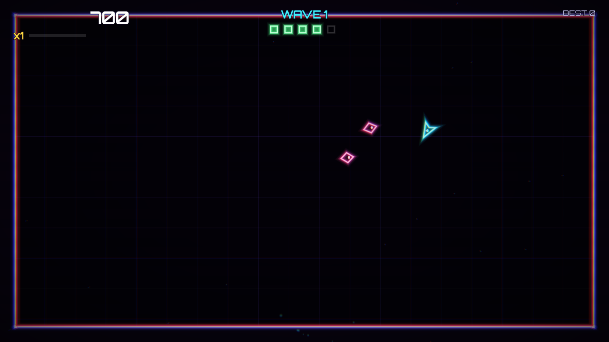

# Neon Drift

**A neon top-down arena survival shooter built in Godot 4. It runs in the browser with no install and no login.**

### ▶ [Play it in your browser](https://fierce-bri.github.io/neon-drift/)



Survive escalating waves of geometric enemies. Chain kills quickly to build a combo multiplier and beat your best score. Every sound is generated procedurally, and all the visuals are vector shapes drawn in code under a custom bloom post-processing shader.

---

## Controls

| Input | Action |
|---|---|
| **WASD / Arrow keys** | Move |
| **Mouse** | Aim |
| **Hold left click** | Shoot |
| **Esc / P** | Pause / resume |
| **R** (paused or game over) | Restart |
| **M** | Mute / unmute |
| **Touch** | Left half of the screen is a virtual stick; right half aims and fires |

## Features

- **Four enemy types with distinct behaviour**, introduced one per wave:
  - **Chaser**: homes in on you with a wobble.
  - **Dasher**: telegraphs an aim line, then launches a high-speed dash.
  - **Shooter**: keeps its distance, strafes, and fires slow projectiles.
  - **Splitter**: tanky; bursts into three fast mini-chasers when destroyed.
- **Wave director** using a point budget that scales with the wave number. Spawns are telegraphed and never placed on top of the player.
- **Pickups**: health and rapid fire.
- **Combo multiplier** (up to ×8). It resets if you get hit or stop killing.
- **Persistent best score**, saved via `user://`, which maps to browser storage (IndexedDB) on the web.
- **Full game flow**: title screen with controls hint, pause, game over, and restart.
- **Juice**: trauma-based screen shake, hit flash, hit-stop, particle explosions with shockwave rings, floating score popups, tweens, and slow motion on death.
- **Custom post-processing shader**: bloom, chromatic aberration, vignette, scanlines, and a damage flash.
- **Procedural audio**: 12 SFX and a music loop, synthesised by a Python script (`scripts/generate_audio.py`). Includes a mute toggle.
- **Responsive**: `canvas_items` stretch with `expand` aspect, so it fills any window size. Touch controls are included.

## Tech

- **Godot 4.3** (GDScript), Compatibility renderer (WebGL 2)
- **Single-threaded web export**: no `SharedArrayBuffer` and no COOP/COEP headers, so it runs on GitHub Pages and itch.io as-is
- **Python** (numpy, wave, plus ffmpeg for the OGG music loop) for procedural sound generation
- **Playwright** for an automated in-browser playtest (`scripts/playtest.py`) and a headless Godot smoke test (`tests/smoke_test.gd`)

## Project structure

```
scenes/              Godot scenes (player, bullet, pickup, enemies/, fx/)
scripts/
  autoload/          GameState (score, combo, best, save), Events (signal bus), Audio (voice pool)
  core/              Arena bounds, neon drawing helpers, camera shake, wave director, web bridge
  entities/          Player, bullet, pickup
  enemies/           Base enemy + chaser, dasher, shooter, splitter
  fx/                Explosion, spawn marker, popup text
  ui/                HUD, menus, health pips, touch controls (built in code)
  main.gd            Game state machine (title, playing, paused, game over)
shaders/             neon_post.gdshader (bloom + CRT-style post-processing)
assets/              Orbitron font (OFL), generated SFX and music
tests/               Headless smoke test
deploy/              nginx vhost used for self-hosting
docs/                Design notes, screenshots, playtest results
```

## Build it yourself

1. Install [Godot 4.3](https://godotengine.org/download/archive/4.3-stable/) and its export templates.
2. Clone the repo and open `project.godot` in the editor, or run it directly:
   ```bash
   git clone https://github.com/fierce-bri/neon-drift.git
   cd neon-drift
   godot --path . 
   ```
3. Export for the web (headless):
   ```bash
   mkdir -p build/web
   godot --headless --export-release "Web" build/web/index.html
   ```
4. Serve `build/web/` with any static web server, for example `python3 -m http.server -d build/web 8000`.

Optional extras:
- Regenerate the audio: `python3 scripts/generate_audio.py`
- Run the smoke test: `godot --headless --script res://tests/smoke_test.gd`

## Credits

- Game design, code, and procedural audio: Aphiwe Mzulwini
- Font: [Orbitron](https://fonts.google.com/specimen/Orbitron), licensed under the SIL Open Font License (`assets/fonts/OFL.txt`)
